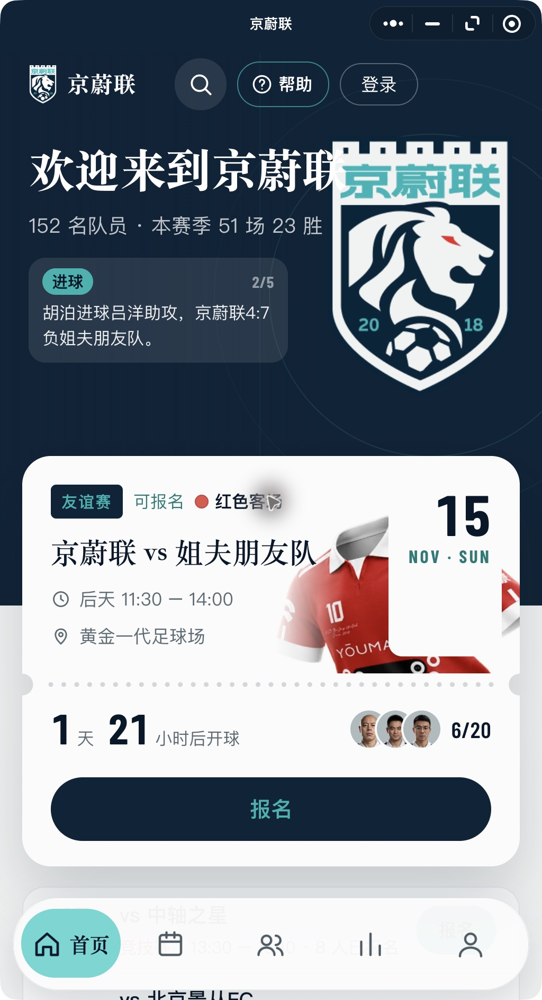
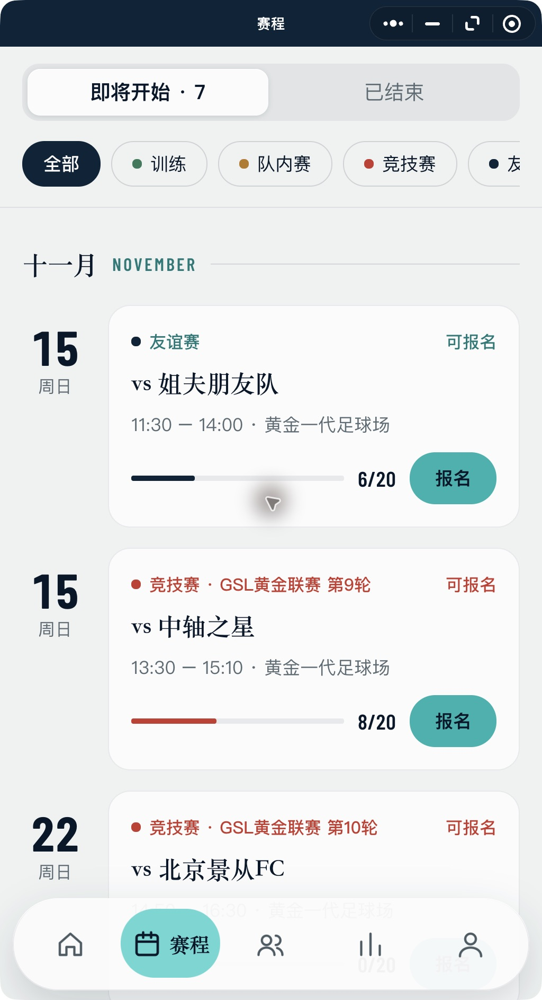
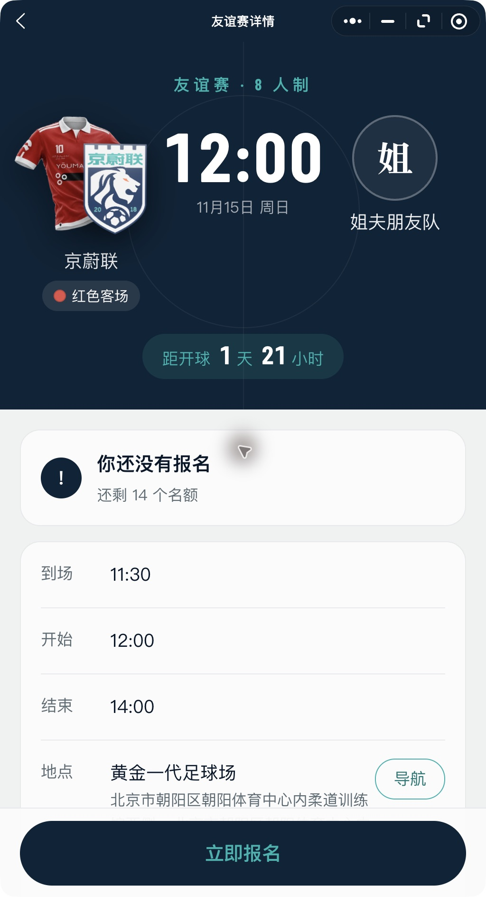
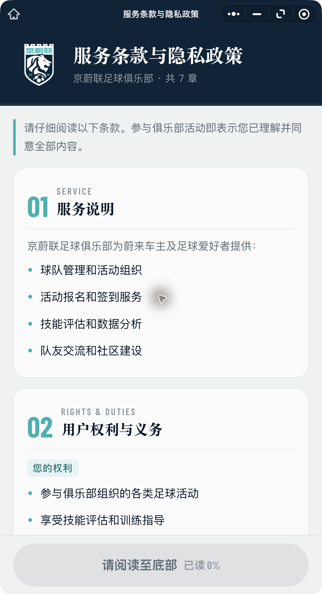

# 微信原生小程序参考研究与交接

研究时间：2026-11-13。目标是供云电脑上的开发代理继续分析与规划，当前不是实现方案的最终批准版。

## 产品方向与证据范围

- 用户明确只考虑微信小程序，以单支业余俱乐部为主；京蔚联是主要参考，大志有球作为辅助参考。现有网页继续作为管理端的建议需在规划时确认。
- 本研究依据当前微信客户端可见界面，京蔚联没有登录。截图仅记录当时的界面和数据，不能推断隐藏权限、服务端规则或所有状态。大志有球的真实界面名称为「大志有球」。
- 证据等级：**已观察**表示看到页面或交互结果；**入口可见**仅代表控件或文字存在；**建议**是本项目设计方向，不能作为竞品已实现的事实。
- `screenshots/` 是原始观察资料，可能含第三方球员昵称、头像和活动信息；仅用于项目内部研究，向外分享或提交前先审查和脱敏。不要将参考产品的标识、图片和个人数据用于本项目产品。

## 京蔚联：主要参考

### 首页（已观察）

队徽和球队名；搜索、帮助、登录入口；球队人数、本赛季比赛及胜场；轮播的比赛动态；突出下一场比赛的卡片，展示比赛类型、报名状态、球衣颜色、对手、日期、时段、地点、开赛倒计时、报名人数/上限、头像和报名按钮。下方有更多比赛。底部有首页、赛程、球员、统计、我的五个导航入口。搜索和帮助的完整行为尚未验证。

### 赛程（已观察）

顶部区分「即将开始」和「已结束」，即将开始显示数量。可按全部、训练、队内赛、竞技赛等类型筛选（横向列表未全部查看），按月份分组；每张卡展示日期、类型/赛事轮次、对手、时间段、场地、报名状态、人数进度和报名入口。[已结束列表](screenshots/jingweil-finished-list.png)包含队内赛、友谊赛和团建，比赛可显示比分和胜负。各类型筛选及报名规则尚未逐一验证。

### 友谊赛详情与对手（已观察）

展示比赛类型和人数制、双方球队、日期和开赛时间、球衣颜色、倒计时、本人报名提示及剩余名额；将到场、开始、结束时间分别列出，显示球场、地址和导航入口，底部固定报名按钮。中部还可见行程距离、建议出发时间、天气及适宜度、队服和须知、对手交锋、按报名阵容估算的概率和猜比分入口；[报名名单](screenshots/jingweil-match-roster.png)包含头像、号码、位置和球探报告。进入页面时出现定位权限申请；拒绝后仍可查看详情。没有提交报名或竞猜。当前项目的 `kickoff` 只表达开球时间，不能用它推断到场或结束时间。

[对手档案](screenshots/jingweil-opponent.png)展示交手胜平负、进失球、对手强度估算和球员进球榜；[历史交手](screenshots/jingweil-opponent-history.png)包括无比分和待赛记录。[模拟页面](screenshots/jingweil-match-simulation.png)称根据历史比分推演 10,000 次，展示胜平负比例、常见比分及净胜球分布，并说明并非结果判断。对手强度、虚拟身价和预测是模型估计，不能当作已发生的比赛事实，也不能假设其算法。

### 赛后、球员和统计（已观察）

| 范围 | 页面证据与观察 | 待验证或设计边界 |
| --- | --- | --- |
| 赛果 | [比分和预测比较](screenshots/jingweil-result.png)；[进球时间、进球人、助攻、描述及回放入口，MVP/评分](screenshots/jingweil-result-goals.png)；分享及生成战报海报入口 | 未生成海报、播放回放或验证评分规则 |
| 阵容与出勤 | [依据填写位置和时长排出的阵容](screenshots/jingweil-result-lineup.png)，展示部分评分和数据覆盖；[照片识别、出场、签到、请假、已填报人数和名单](screenshots/jingweil-result-attendance.png) | 展示阵容不等同已证实首发；报名、签到和实际出场分别建模；识别与签到流程未操作 |
| 球员 | [列表](screenshots/jingweil-players.png)提供姓名/号码搜索、排序、位置分类、筛选、对比和队友圈入口；[筛选](screenshots/jingweil-player-filter.png)包括年龄、喜爱球队和球星 | 对比、队友圈的实际行为未验证；个人偏好筛选不必直接纳入本项目 |
| 球员档案 | [资料首屏](screenshots/jingweil-player-profile.png)显示位置、年龄、入队时长、惯用脚、近期状态、虚拟身价、京蔚值、出场/进球/助攻/MVP；[数据](screenshots/jingweil-player-data.png)有生涯/年份、每月进球助攻和出勤日历；[荣誉](screenshots/jingweil-player-honors.png)显示勋章、稀有度和日期 | 身价、状态和京蔚值的公式未知；资料页下方未完整核对 |
| 榜单 | [统计](screenshots/jingweil-statistics.png)按出场、参与、进球、助攻、MVP、身价等分类，可选年份、比赛类型；有数据完整度和最佳十一人入口 | 完整度及最佳十一人的具体规则未验证，缺失数据不能视为零 |
| 数据实验室 | [汇总](screenshots/jingweil-lab.png)与[详情](screenshots/jingweil-lab-details.png)支持年份、近 10/30 场及全部，展示胜平负、进失球、进球时间、射门区域/落点、助攻组合、点球档案及数据覆盖 | 部分按人分析标注正式会员可看；录入方式、所有筛选组合未知 |
| 虚拟联赛 | [积分、射手、助攻、抢断、MVP、我的比赛](screenshots/jingweil-virtual-league.png) | 具体赛制及个人页面未验证；不作为首期默认范围 |
| 我的 | [访客页](screenshots/jingweil-my-guest.png)说明登录后可看本人赛季数据、身价、勋章和队友；有球队规则、近期新功能入口 | 本人数据及球队规则正文未验证；[新功能介绍](screenshots/jingweil-whats-new.png)宣称可跳转蔚来小程序签到，实际流程未验证 |

### 服务说明（仅文字宣称）

服务条款页列出球队管理和活动组织、活动报名和签到、技能评估和数据分析、队友交流和社区建设。这是产品自己的服务说明，**不代表已经验证对应功能或实际规则**。

### 覆盖核对与限制

本轮已查看京蔚联首页、赛程、未来友谊赛、已结束列表与一场赛果、对手、球员列表与档案、统计、实验室、虚拟联赛和访客个人页。京蔚联无法登录，因此成员操作、后台管理、报名和签到真实规则、通知与完整权限不可验证；搜索、帮助、球队规则、球员对比/队友圈、不同活动类型详情和全部筛选组合也仍未逐一核对。截图和观察覆盖的是样本，不能声称穷尽所有页面或状态。

此前控制恢复后完成上述页面操作；最后复核时页面内容点击未响应，重新进入后京蔚联窗口未恢复，大志有球窗口的坐标操作再次返回 `noWindowsAvailable`。本次补充走查因此中断，待窗口恢复后按上述清单继续。大志有球的复核以现存截图和上轮观察为依据，不表示本次重新操作了全部页面。

## 大志有球：辅助参考

| 页面/证据 | 已观察到的内容 | 对单俱乐部的意义 |
| --- | --- | --- |
| [活动首页](screenshots/dazhi-home.png) | 日期、综合排序、地区、地图入口；卡片有场地、时间、人数制、成场/满员人数、活动标签、报名人数 | 参考时间筛选、活动摘要和人数可见性；跨城市活动市场不作为默认范围 |
| [活动详情](screenshots/dazhi-activity.png) | 时间、球场、导航入口、场地号、费用提示、公告；报名/待定/请假计数；分组与未分组成员；留言、分享、报名入口 | 用于讨论详情、报名状态及分队，费用/交易另议；未提交报名 |
| [报名详情](screenshots/dazhi-registration-list.png) | 已报名名单、报名时间及邀请来源 | 考虑成员可见范围和时间记录；是否允许代报名需另定 |
| [球队列表](screenshots/dazhi-teams.png)、[球队名片](screenshots/dazhi-team-card.png) | 示例球队；名片有名称、标识、介绍、标签、成立年份、招人/约队说明、成员/活动/动态计数、照片，以及联系、申请和分享入口 | 参考轻量球队介绍；公开招募、约队等不是首期默认需求 |
| [发起活动](screenshots/dazhi-create-activity.png)、[规则](screenshots/dazhi-create-rules.png)、[选项](screenshots/dazhi-create-options.png) | 表单可见封面、球队、时间、位置、类型、公告、人数上限、分队、报名截止、收费、曝光、标签、联系方式、待定、签到及保存模板；未创建活动 | 人数、截止时间、训练、签到和模板值得需求评估；收费、安全服务和平台曝光另行决策 |
| [分队设置](screenshots/dazhi-group-settings.png) | 队名、添加队伍、随机分配/自主选择开关、每队人数上限 | 仅表明配置入口存在；互斥、分配算法与实际提交结果未验证 |
| [球场](screenshots/dazhi-venues.png)、[详情](screenshots/dazhi-venue-detail.png) | 场地列表、距离、人数制、预约入口、介绍与导航 | 本项目优先保存比赛地点；商业订场及平台场地库暂不默认纳入 |
| [个人中心](screenshots/dazhi-profile.png)、[更多](screenshots/dazhi-more.png) | 钱包、账单、优惠券、历史活动、个人主页、黑名单、水平、球场订单、球友、赛事、会员、提醒入口 | 大多属于平台经营功能；入口可见不等于已验证业务 |

没有执行报名、付款、创建活动、申请加入或对外留言。上述界面没有证实完整交易、退款、权限或状态流转。

## 与当前代码的初步对照

详见仓库 `README.md` 和 `docs/club-api.md`，规划前以当前代码和测试复核：

| 领域 | 当前能力 | 需评估的差距 |
| --- | --- | --- |
| 球队/球员 | 一支球队界面；名称、队徽、球员档案、归档；管理员与球员角色 | 小程序友好展示、成员身份绑定与隐私可见性；不自动扩展为多球队平台 |
| 赛程 | 比赛草稿、发布、取消、完赛；赛事、对手、日期、开球、地点、人数制、主客场、赛季 | 类型是否涵盖训练/队内活动；结束时间、球衣颜色、人数上限/截止等并非现有合同字段；训练是否复用比赛模型需先建模 |
| 报名 | 球员本人对已发布比赛选择参加/不参加/待定 | 上限、截止、候补及并发控制需产品决定；不要把报名当作签到或出场 |
| 名单与赛果 | 首发/替补、独立实际出场、比分、进球、助攻、复盘；历史身份和战术快照 | 小程序适合的只读呈现、管理权限和数据完整性提示 |
| 统计/赛季 | 按自然年或显式赛季统计、胜平负、进失球、对手、报名与实际出场及覆盖 | 规划可视化，保留未知值、数据覆盖及显式赛季语义 |
| 战术 | 网页战术板与历史快照 | 是否在小程序只读展示；不假设完整编辑适合移动端 |
| 认证 | 用户名密码、服务端 cookie 会话；所有俱乐部数据需认证；写请求校验 Origin | 微信身份认证、账号绑定、吊销和客户端请求防护需设计与测试，现有机制不能直接假设可用于小程序 |

## 初步取舍：供规划讨论

以下是基于单俱乐部定位的建议，不代表用户已批准需求或竞品已验证规则。

| 优先级 | 建议范围 | 原因与边界 |
| --- | --- | --- |
| P0：成员闭环 | 微信身份与现有球员安全绑定；首页下一场；赛程和详情；本人参加/不参加/待定；名单；已结束比赛、比分与个人基础统计 | 复用已有比赛和数据，先明确访问权限、历史数据和网页/小程序一致性。上限与截止只有产品确认后才加入 |
| P1：组织效率 | 训练/团建等活动、集合和结束时间、队服及注意事项、人数上限/截止、签到、分队、提醒 | 先确认实际组织流程、维护成本和状态语义；签到应有人工纠错与审计，定位不是必要前提 |
| P2：球队沉淀 | 对手交手历史、球员档案、赛季榜单、赛后战报、荣誉 | 优先真实、可追溯数据和覆盖率；缺失与零分开，先确认隐私及管理员维护责任 |
| 暂缓或独立立项 | 预测模拟、虚拟身价/联赛、照片识别、平台活动市场、公开招募、支付与订场 | 分别依赖充足数据、算法、运营或外部服务；当前没有证据证明它们是俱乐部核心需求 |

微信原生小程序适合当前只面向微信的目标，可直接使用微信组件和能力，但效率取决于现有后端接口、身份体系与开发经验。它不会自动复用 Vue 页面；小程序网络、会话、合法域名及部署要求需要单独验证。保留现有网页作为管理端是待讨论建议，不是既定决定。

### 规划时必须回答的问题

1. 访客是否能看赛程、名单、比分和球员个人数据？成员、组织者、管理员的查看和编辑范围是什么？球员绑定、解绑、离队及账号找回由谁审批？
2. 训练、团建、队内赛和对外比赛共享哪些字段、状态及统计口径？现有历史比赛如何迁移？
3. 报名截止、人数上限、候补、代报名、取消资格和管理员调整是否需要？同一名额被并发抢占时如何处理？
4. 签到、请假、报名、实际出场、首发/替补各自如何记录与纠错？无数据时如何表现，哪些值允许由管理员补录？
5. 比分、进球、助攻、MVP、比赛时长和赛季归属的事实来源及修订规则是什么？公开和历史统计如何处理未录入记录？
6. 球队照片、头像、个人资料、地址、分享和通知各面向谁可见？提醒发送时机与授权如何管理？
7. AppID、HTTPS 和合法域名、后端部署、数据备份、微信登录及与现有账户关联由谁提供？如何在不接触生产数据库的情况下开发验收？

### 建议验收场景

- 成员成功绑定后能看到被授权的数据；未绑定、已解绑、会话过期及无权限时有明确提示，不能凭客户端传入球员 ID 冒充他人。
- 赛程正确显示未来、已结束和取消的活动；详情中的集合、开始、结束时间与地点按实际存储呈现，缺失值不虚构。
- 成员修改三态报名后，刷新、换端及管理网页结果一致；取消或状态变化时遵循最终确定的规则。若启用限额/截止，应覆盖并发、满员、截止和管理员调整。
- 报名、签到、实际出场互不自动等同；赛果、进球助攻和统计能追溯原记录，缺失、未完成与零有区别，历史快照保持稳定。
- 无数据、网络失败、重复请求、权限不足和过期会话均有可恢复反馈；迁移和回滚在隔离数据库验证，既有服务端及浏览器测试继续通过。

## 给云电脑的分析与规划任务

1. 先核对当前代码、测试和用户最新指令；将观察事实、竞品未验证行为、项目建议分开，不把任何截图直接转成确定需求。
2. 以单俱乐部成员的赛前、赛中、赛后流程梳理目标与角色：访客、已绑定球员、管理员各能看和做什么；特别明确隐私与是否提供访客数据。
3. 给出微信原生小程序的信息架构、核心页面和状态：加载/空/错误/无权限/取消/已满/截止/未知数据。区分训练、友谊赛、正式比赛是否需要不同模型。
4. 形成分期与取舍：先保证现有球队、赛程、报名、名单和统计闭环；再按实际需求决定训练、签到、分队、消息提醒；平台化发现、支付、场地交易等不因竞品有入口而自动纳入。
5. 对照现有 API、数据库和测试列出复用及变更；明确微信身份与现有用户/球员绑定和解绑、成员归属、认证、过期及权限；沿用现有业务不变量和历史快照。评估并发报名、截止与人数上限、迁移兼容和回滚。
6. 输出可讨论的产品规格、页面清单与流程、数据/API 草案、风险及未决问题、分阶段实施任务和验收测试；区分先决配置（AppID、服务器 HTTPS 与域名等）和可用本地模拟完成的开发。

本次交接不是要求立即实现或部署。参考产品的视觉素材、队徽、数据和文案不应直接复制。
